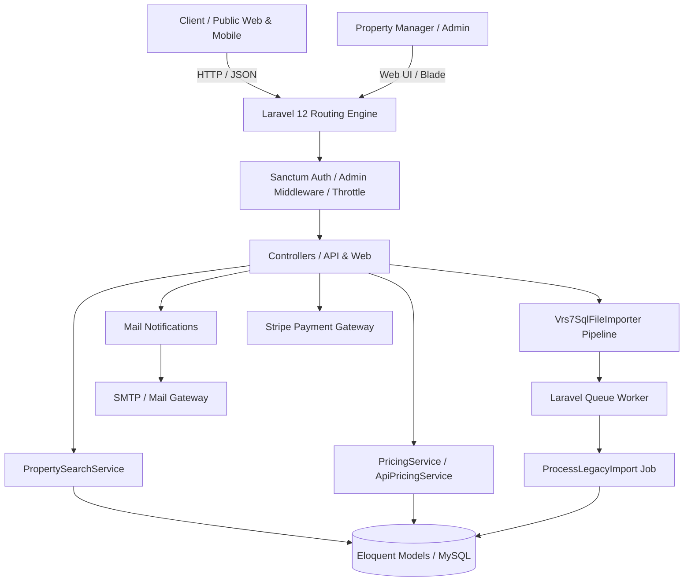
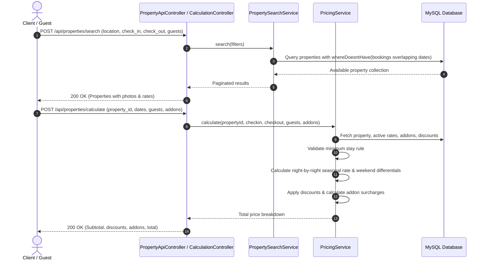
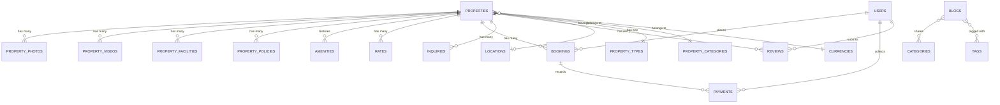

# E-Holidaysvillas

> Enterprise luxury vacation rental and property management platform built with Laravel 12, featuring real-time availability checks, multi-season dynamic pricing, and automated legacy database migration.

<p align="center">
  
</p>

<p align="center">
  <a href="https://github.com/imtiaz-ahamed-hridoy/E-Holidaysvillas"></a>
  <a href="https://laravel.com"></a>
  <a href="https://www.php.net/"></a>
  <a href="https://www.mysql.com/"></a>
  <a href="https://tailwindcss.com/"></a>
  <a href="https://alpinejs.dev/"></a>
  <a href="https://stripe.com"></a>
  <a href="https://pestphp.com/"></a>
  <a href="LICENSE"></a>
</p>

---

## Table of Contents

- [1. Project Name](#1-project-name)
- [2. Used Technologies](#2-used-technologies)
- [3. Project Overview](#3-project-overview)
- [4. System Architecture & Workflow](#4-system-architecture--workflow)
- [5. Key Functional Modules & Flows](#5--key-functional-modules--flows)
- [6. Project Structure & API Reference](#6-project-structure)
  - [Folder Tree](#folder-tree)
  - [Complete API Reference](#complete-api-reference)
  - [Database Entities & Relationships](#database-entities--relationships-summary)
- [7. Environment Configuration (.env)](#7-environment-configuration-env)
- [8. Installation & Setup Commands](#8-installation--setup-commands)
- [9. Running the Application](#9-running-the-application)
- [10. Testing & Code Quality](#10-testing--code-quality)
- [11. CI/CD & Deployment](#cicd--deployment)
- [12. My Role & Contributions](#my-role--contributions)
- [13. Showcase Disclaimer](#showcase-disclaimer)

---

## 1. Project Name

**E-Holidaysvillas**: An enterprise vacation rental and villa hospitality management engine providing collision-free calendar search, high-concurrency dynamic seasonal quote calculations, inquiry routing, and automated legacy database migration.

---

## 2. Used Technologies

### Backend & Core Framework
- **PHP**: `^8.2` (tested with PHP 8.4)
- **Framework**: **Laravel 12** (`^12.0`)
- **Authentication**: **Laravel Sanctum** (`^4.0`), **Laravel Socialite** (`^5.21`)
- **Verification**: **IchTrojan Laravel OTP** (`^2.0`)
- **HTTP Client**: **GuzzleHttp** (`^7.10`)
- **CLI & REPL**: **Laravel Tinker** (`^2.11`)

### Frontend & Admin UI
- **Template Engine**: Laravel Blade
- **CSS Framework**: **TailwindCSS** (`^3.1.0`), `@tailwindcss/forms` (`^0.5.2`), `@tailwindcss/vite` (`^4.0.0`)
- **Interactive Scripting**: **Alpine.js** (`^3.4.2`), Axios (`^1.8.2`)
- **Asset Bundler**: **Vite** (`^6.2.4`), `laravel-vite-plugin` (`^1.2.0`)
- **Data Grids**: **Yajra Laravel DataTables** (`12.*`)

### Database & Storage
- **Database Engine**: MySQL 8.0+ / MariaDB
- **ORM**: Eloquent ORM with Database Transactions & Soft Deletes
- **Queue & Cache Drivers**: Database queue driver, Redis-ready (`phpredis`)

### Third-Party Integrations
- **Payment Processing**: **Stripe PHP SDK** (`^16.6`)
- **Geocoding & Maps**: Google Maps API
- **Transactional Email**: SMTP / Mailgun / Resend with Laravel Mailable templates
- **Travel Distribution Hooks**: Hotelbeds API schema integration

### DevOps, Testing & Quality
- **Test Framework**: **Pest PHP** (`^3.8`), **Pest Plugin Laravel** (`^3.2`), PHPUnit (`^11.0`)
- **Code Style & Linting**: **Laravel Pint** (`^1.13`)
- **CI/CD Pipeline**: GitHub Actions (generic FTPS/SFTP deployment workflow template)
- **Local Dev Container**: Laravel Sail (`^1.41`)

---

## 3. Project Overview

### Problem Statement
Managing high-end luxury vacation rentals presents severe domain complexities:
1. **Multi-Tier Seasonal Pricing**: A property rarely has a fixed nightly price. Rates vary dramatically across peak summer seasons, shoulder months, holiday weekends, and minimum-night duration thresholds.
2. **Double-Booking Collisions**: Inquiries and simultaneous reservations across booking channels risk double-allocating the same villa during overlapping check-in/out date ranges.
3. **Legacy Ingestion Latency**: Transitioning an established rental business from older software architectures (such as legacy VRS7 systems) typically involves ingesting multi-gigabyte SQL dumps with thousands of properties, unoptimized photos, and historical booking logs without data corruption.

### Business Value & Solutions
- **Real-Time Collision-Free Availability**: The search engine utilizes optimized SQL subqueries (`whereDoesntHave`) to guarantee that any property with an active, confirmed, or checked-in booking across the queried calendar window is immediately excluded from search results.
- **Dynamic Night-by-Night Pricing Engine**: The custom `PricingService` iterates through every individual night of a prospective reservation, mapping date-specific seasonal rates, weekend differentials, minimum-stay validation, custom discounts, and optional addon fees into an itemized transparent quote.
- **Memory-Safe Legacy Migration Pipeline**: A purpose-built command-line and queue pipeline (`Vrs7SqlFileImporter` & `ProcessLegacyImport`) processes raw legacy MySQL dumps via streaming regex parsers, asynchronously downloading, validating, and normalizing thousands of villa photos and amenities into modern Eloquent models.

---

## 4. System Architecture & Workflow

### High-Level Request & Layer Architecture



### Date Availability & Pricing Workflow



---

## 5. Key Functional Modules & Flows

### 1. Property Catalog & Collision-Free Search
- **Roles**: Public Guest, API Consumer
- **Flow**:
  1. The guest submits search parameters: location (country, state, city, area), guest count, property type, and target check-in / check-out dates.
  2. `PropertySearchService` constructs an optimized query filtering active properties where `allow_bookings = true`.
  3. The service applies an availability filter that excludes properties with any booking in `pending`, `confirmed`, or `checked_in` status overlapping the requested range.
  4. Returns paginated properties with eager-loaded locations, featured photos, and applicable seasonal rates.

### 2. Dynamic Seasonal Pricing Engine
- **Roles**: Public Guest, Admin, Property Manager
- **Flow**:
  1. Request passes `property_id`, `checkin_date`, `checkout_date`, and optional addon/discount parameters to `/api/properties/calculate`.
  2. `PricingService` verifies that the stay duration satisfies `min_no_of_stay`.
  3. The engine loops across each night: checks if a seasonal `Rate` model covers that specific calendar day; if not, falls back to the property base rate.
  4. Adds weekend price differentials if configured.
  5. Applies flat or percentage discounts and incorporates requested addon services.
  6. Returns a detailed quote breakdown with subtotal, discounts, addons, and final payable amount.

### 3. Booking & Availability Calendar Management
- **Roles**: Admin, Property Manager
- **Flow**:
  1. The administrator visits `/admin/property-availability/{id}` to view an interactive FullCalendar view.
  2. The frontend calls `/admin/property-availability/{id}/events` to render reserved, pending, and blocked dates with color-coded tags.
  3. The manager can manually block dates, alter customer booking statuses (`pending`, `confirmed`, `cancelled`), or simulate quotes via `/admin/property-availability/calculate-price`.

### 4. Property Inquiries & Lead Management
- **Roles**: Guest, Admin
- **Flow**:
  1. Guest submits a direct booking or property inquiry via `POST /api/inquiry/contact`.
  2. System stores the inquiry record linked to the property, guest name, email, phone, requested dates, and message.
  3. `AdminInquiryMail` is triggered via Laravel Mailables to notify the administrative team.
  4. Administrators review inquiry details in the backend portal (`/admin/inquiry/{id}`) and send replies directly to the client via `InquiryReplyMail`.

### 5. Legacy VRS7 Data Migration Pipeline
- **Roles**: System Administrator / DevOps
- **Flow**:
  1. Administrator triggers import via CLI (`php artisan legacy:import-vrs7`) or Web UI (`/admin/property-import`).
  2. `Vrs7SqlFileImporter` streams the SQL dump in memory-safe chunks, parsing table schemas (`vrs7_listings`, `vrs7_listing_photos`, `vrs7_rates`, `vrs7_bookings`, `vrs7_policies`).
  3. Dispatches `ProcessLegacyImport` queue jobs to asynchronously download remote photo assets, verifying file sizes and bypassing challenge pages.
  4. Normalizes legacy identifiers into modern relational tables wrapped inside transactional batches.

### 6. Administration & CMS Portal
- **Roles**: Super Admin, Staff
- **Flow**:
  1. Secure authentication via `/login` with `Admin` middleware protection.
  2. Data management via server-side Yajra DataTables: Properties, Addons, Discounts, Amenities, Categories, and Unit Types.
  3. Content Management System: Dynamic Pages (Terms, Privacy), Blogs, Categories, Tags, and FAQ management.
  4. System & Mail Settings: Configurable branding, contact email, and SMTP credentials.

---

## 6. Project Structure

### Folder Tree
```
e-holidaysvillas/
├── app/
│   ├── Console/Commands/       # Artisan commands (ImportVrs7Sql)
│   ├── Helpers/                # Global helper utilities (Helper.php)
│   ├── Http/
│   │   ├── Controllers/
│   │   │   ├── API/            # REST API Controllers (Properties, Inquiry, Auth, etc.)
│   │   │   ├── Auth/           # Authentication controllers (Breeze/Sanctum)
│   │   │   └── Web/Backend/    # Admin portal controllers (Properties, Rates, Bookings)
│   │   └── Middleware/         # AdminMiddleware & route guards
│   ├── Jobs/                   # Queued jobs (ProcessLegacyImport)
│   ├── Mail/                   # Mailables (BookingConfirmation, AdminInquiry, OTP)
│   ├── Models/                 # Eloquent Models (Property, Booking, Rate, User, etc.)
│   └── Services/               # Domain business logic:
│       ├── PricingService.php          # Core pricing calculation engine
│       ├── PropertySearchService.php   # Availability & collision-free search
│       └── Legacy/                     # VRS7 SQL dump importer engine
├── bootstrap/app.php           # Modern Laravel 12 application configuration & routes
├── config/                     # Framework & service configurations
├── database/
│   ├── data/                   # Country/State geographic seed data
│   ├── factories/              # Model factories for testing
│   ├── migrations/             # Schema definitions (35 migrations)
│   └── seeders/                # Database seeders (Users, Settings, Blogs, Locations)
├── docs/                       # Project documentation (DEPLOYMENT.md)
├── public/                     # Web entry point (index.php) and compiled assets
├── resources/
│   ├── css/                    # TailwindCSS stylesheet inputs
│   ├── js/                     # JavaScript bundle entry points
│   └── views/                  # Blade templates (Admin dashboard, emails, layouts)
├── routes/
│   ├── api.php                 # Public REST API routes
│   ├── auth.php                # Authentication routes
│   ├── backend.php             # Admin backend routes
│   ├── console.php             # Console schedules & queue worker tasks
│   ├── settings.php            # Admin system & mail settings routes
│   └── web.php                 # Web entry point routes
└── tests/
    ├── Feature/                # Feature test suites (Property search API, Auth)
    └── Unit/                   # Unit test cases
```

---

### Complete API Reference

#### 1. Geographic & Location Lookups
| Method | Endpoint | Auth | Description | Request / Response Summary |
| :--- | :--- | :--- | :--- | :--- |
| `GET` | `/api/location/countries` | None | List all supported world countries | Response: `[ { id, name, iso2 } ]` |
| `GET` | `/api/location/states/{country_id}` | None | Get states/regions for country | Param: `country_id`. Response: State list |
| `GET` | `/api/location/cities/{state_id}` | None | Get cities for state | Param: `state_id`. Response: City list |
| `GET` | `/api/location/find-country` | None | Search country by name | Query: `name`. Response: Country object |
| `GET` | `/api/location/find-state` | None | Search state by name | Query: `name`. Response: State object |
| `GET` | `/api/location/find-city` | None | Search city by name | Query: `name`. Response: City object |

#### 2. Destinations
| Method | Endpoint | Auth | Description | Request / Response Summary |
| :--- | :--- | :--- | :--- | :--- |
| `GET` | `/api/destinations` | None | List featured destination cities | Response: City destinations with property counts |
| `GET` | `/api/destinations/{city}` | None | Get city details & properties | Param: `city`. Response: City metadata |
| `GET` | `/api/destinations/{city}/{area}` | None | Get specific area within destination | Params: `city`, `area`. Response: Area metadata |

#### 3. Properties & Search
| Method | Endpoint | Auth | Description | Request / Response Summary |
| :--- | :--- | :--- | :--- | :--- |
| `POST` | `/api/properties/search` | None | Search available properties without date conflicts | Body: `{ location, check_in, check_out, guests, property_type_id, per_page }`. Response: Paginated properties |
| `GET` | `/api/properties` | None | List all active properties | Response: Paginated property list |
| `GET` | `/api/properties/{id}` | None | Get comprehensive property details | Param: `id`. Response: Property with photos, rates, amenities, policies |
| `GET` | `/api/properties/explore/{category_id}` | None | Explore properties by category | Param: `property_category_id`. Response: Filtered list |
| `POST` | `/api/properties/explore/popular-nearby` | None | Get popular properties near location | Body: `{ country, city, area }`. Response: Popular properties ordered by ratings & reviews |

#### 4. Pricing Calculation & Rates
| Method | Endpoint | Auth | Description | Request / Response Summary |
| :--- | :--- | :--- | :--- | :--- |
| `POST` | `/api/properties/calculate` | None | Calculate exact stay pricing quote | Body: `{ property_id, checkin_date, checkout_date, no_of_guests }`. Response: Detailed price breakdown |
| `GET` | `/api/rates` | None | List general rates | Response: Rate records |
| `GET` | `/api/rates/{property_id}` | None | Get active seasonal rates for property | Param: `property_id`. Response: Rate collection |

#### 5. Inquiries & Customer Communications
| Method | Endpoint | Auth | Description | Request / Response Summary |
| :--- | :--- | :--- | :--- | :--- |
| `POST` | `/api/inquiry/contact` | None | Submit property booking inquiry | Body: `{ property_id, name, email, phone, checkin_date, checkout_date, no_of_guests, message }`. Response: Status message & inquiry ID |

#### 6. Taxonomy, CMS & Content
| Method | Endpoint | Auth | Description | Request / Response Summary |
| :--- | :--- | :--- | :--- | :--- |
| `GET` | `/api/property-categories` | None | List property categories | Response: Categories (e.g. Luxury Villas) |
| `GET` | `/api/property-types` | None | List property types | Response: Types (e.g. Villa, Chalet) |
| `GET` | `/api/system-setting` | None | Get public system branding & settings | Response: Title, logo, copyright, contact info |
| `GET` | `/api/about-us` | None | Get About Us content | Response: About content & media |
| `GET` | `/api/list` | None | List dynamic CMS pages | Response: Terms, Privacy, custom pages |
| `POST` | `/api/show/{id}` | None | Show specific CMS page | Param: `id`. Response: Page HTML content |
| `GET` | `/api/blog` | None | List blog articles | Response: Paginated posts with tags/categories |
| `GET` | `/api/blog/{id}` | None | Show blog post details | Param: `id`. Response: Post detail |
| `GET` | `/api/categories` | None | List blog categories | Response: Category list |
| `GET` | `/api/tags` | None | List blog tags | Response: Tag list |
| `GET` | `/api/reviews` | None | List published customer reviews | Response: Paginated reviews |

#### 7. Authenticated User & Profile Management
| Method | Endpoint | Auth | Description | Request / Response Summary |
| :--- | :--- | :--- | :--- | :--- |
| `GET` | `/api/profile` | `auth:sanctum` | Get authenticated user profile | Response: User data & metadata |
| `POST` | `/api/profile/update` | `auth:sanctum` | Update user profile information | Body: `{ first_name, last_name, avatar }` |
| `POST` | `/api/profile/change-password` | `auth:sanctum` | Change user account password | Body: `{ current_password, new_password, new_password_confirmation }` |
| `POST` | `/api/profile/delete-account` | `auth:sanctum` | Self-delete user account | Body: `{ password }` |
| `POST` | `/api/logout` | `auth:sanctum` | Revoke active access token | Response: `{"message": "Logged out"}` |
| `GET` | `/api/faq` | `auth:sanctum` | Access authenticated FAQs | Response: FAQ list |

#### 8. Admin Booking & Availability Management
| Method | Endpoint | Auth | Description | Request / Response Summary |
| :--- | :--- | :--- | :--- | :--- |
| `GET` | `/admin/bookings` | Admin Auth | List all reservations with server-side DataTable | Response: JSON / Blade view with guest, property, status badges |
| `GET` | `/admin/bookings/{id}` | Admin Auth | View full booking invoice, guest data & payment history | Param: `id`. Response: Detailed booking view |
| `PUT` | `/admin/bookings/{id}` | Admin Auth | Update reservation status, payment state, guest info | Body: `{ booking_status, payment_status, guest_name, ... }` |
| `POST` | `/admin/bookings/{id}/payment` | Admin Auth | Record payment installment & trigger receipt email | Body: `{ amount, payment_method, payment_date, notes }` |
| `DELETE` | `/admin/bookings/{id}` | Admin Auth | Delete reservation record | Param: `id`. Response: Success status |
| `GET` | `/admin/property-availability` | Admin Auth | Interactive visual calendar of booked & open dates | Response: Calendar view with property picker |
| `POST` | `/admin/property-availability/store` | Admin Auth | Create administrative reservation directly from calendar | Body: `{ property_id, check_in, check_out, guest_name, ... }` |
| `POST` | `/admin/property-availability/calculate-price` | Admin Auth | Calculate admin price quote with custom rates | Body: `{ property_id, checkin_date, checkout_date, ... }` |

#### 9. Admin Catalog, CMS & Platform Management
| Method | Endpoint | Auth | Description | Key Request / Response Fields |
| :--- | :--- | :--- | :--- | :--- |
| `GET/POST` | `/admin/property` | Admin Auth | Property management (listing, create, edit, delete, status toggle) | DataTables JSON / View, full property specs & photos |
| `GET/POST` | `/admin/property-type` | Admin Auth | Manage property types (Villa, Chalet, Apartment, etc.) | Title, slug, active status |
| `GET/POST` | `/admin/unit-type` | Admin Auth | Manage unit types (Entire Villa, Private Room, etc.) | Title, slug, active status |
| `GET/POST` | `/admin/property-category` | Admin Auth | Manage property categories & classifications | Title, slug, status |
| `GET/POST` | `/admin/currency` | Admin Auth | Multi-currency configuration & exchange rates | Currency code, symbol, exchange rate |
| `GET/POST` | `/admin/rate` | Admin Auth | Seasonal rate matrix (nightly, weekend, extra guest, min stay) | Date ranges, nightly prices, extra person fees |
| `GET/POST` | `/admin/amenities` | Admin Auth | Master amenities catalog (swimming pool, wifi, AC, etc.) | Title, icon SVG/image, active status |
| `GET/POST` | `/admin/addons` | Admin Auth | Manage optional extra services and fees | Addon title, price, status |
| `GET/POST` | `/admin/discounts` | Admin Auth | Manage seasonal discount campaigns | Percentage / fixed discount, date ranges |
| `GET` | `/admin/inquiry` | Admin Auth | Guest inquiries review & management | Inquiry list, guest details, date requests, reply mail |
| `GET/POST` | `/admin/review` | Admin Auth | Customer review moderation & management | Star ratings, review comments, status toggle |
| `GET/POST` | `/admin/blog` | Admin Auth | Editorial blog articles, categories & tag taxonomy | Post title, markdown/HTML content, featured image |
| `GET/POST` | `/admin/page` | Admin Auth | Dynamic CMS pages (Terms, Privacy Policy) | Page title, slug, content body |
| `GET/POST` | `/admin/faq` | Admin Auth | Frequently Asked Questions knowledgebase | Question, answer, ordering |
| `GET/POST` | `/admin/property-import` | Admin Auth | Legacy VRS7 SQL bulk import with queue progress tracking | `.sql` dump upload, real-time AJAX polling progress |
| `GET/PATCH`| `/admin/settings/system-setting` | Admin Auth | Platform branding, logos, contact email, copyright | System title, logo/favicon upload, contact details |
| `GET/PATCH`| `/admin/settings/mail-setting` | Admin Auth | SMTP mail server credentials & configuration | Host, port, username, password, encryption |
| `GET/PUT`  | `/admin/settings/stripe/edit` | Admin Auth | Stripe payment gateway keys configuration | Publishable key, secret key, webhook secret |

---

### Database Entities & Relationships Summary



1. **`Property`**: Core entity containing title, slug, room counts, guest capacity, pricing references, and coordinates.
2. **`Location`**: Geographic hierarchy mapping properties to country, state/region, city, and area.
3. **`Rate`**: Seasonal pricing definitions with start/end date ranges, nightly rates, weekend surcharges, and minimum night requirements.
4. **`Booking`**: Reservation records containing customer info, check-in/out dates, price calculations, and statuses (`pending`, `confirmed`, `checked_in`, `cancelled`).
5. **`Payment`**: Financial transaction logs linked to bookings, tracking installment amounts, payment gateways/methods, collected-by admin, and receipt timestamps.
6. **`Amenity`**: Master amenity catalog with SVG/image icons, status toggles, and optional property associations.
7. **`Inquiry`**: Guest inquiries regarding property availability and custom arrangements.
8. **`PropertyPhoto` & `PropertyVideo`**: Media galleries linked to properties.
9. **`PropertyFacility` & `PropertyPolicy`**: Structured facilities, house rules, and cancellation policies.
10. **`User`**: Account model supporting RBAC (`Admin`, `User`) and Sanctum token authentication.

---


## 7. Environment Configuration (.env)

Duplicate `.env.example` to `.env` and set the required variables:

```bash
cp .env.example .env
```

| Variable | Purpose | Example Placeholder |
| :--- | :--- | :--- |
| `APP_NAME` | Name of the application | `"e-holidaysvillas"` |
| `APP_ENV` | Application environment mode | `local` / `production` |
| `APP_KEY` | Laravel 32-character encryption key | Generate via `php artisan key:generate` |
| `APP_DEBUG` | Enable/disable debug stack traces | `true` (local) / `false` (prod) |
| `APP_URL` | Base canonical application URL | `https://example.com` |
| `FRONTEND_APP_URL` | Associated SPA/Frontend application URL | `https://example.com` |
| `DB_CONNECTION` | Database driver | `mysql` |
| `DB_HOST` | Database server hostname | `127.0.0.1` |
| `DB_PORT` | Database server port | `3306` |
| `DB_DATABASE` | Database schema name | `e_holidaysvillas` |
| `DB_USERNAME` | Database user | `db_user` |
| `DB_PASSWORD` | Database password | `db_password` |
| `SESSION_DRIVER` | Session storage engine | `database` |
| `QUEUE_CONNECTION` | Background queue driver | `database` |
| `CACHE_STORE` | Cache storage engine | `database` |
| `MAIL_MAILER` | Mail transport driver | `smtp` |
| `MAIL_HOST` | SMTP server host | `smtp.mailgun.org` |
| `MAIL_PORT` | SMTP port | `587` |
| `MAIL_USERNAME` | SMTP account username | `smtp_username` |
| `MAIL_PASSWORD` | SMTP account password | `smtp_password` |
| `MAIL_ENCRYPTION` | SMTP TLS encryption | `tls` |
| `MAIL_FROM_ADDRESS`| Default outgoing email address | `"info@example.com"` |
| `GOOGLE_MAPS_API_KEY` | Google Maps JavaScript/Geocoding key | `your-google-maps-api-key` |
| `STRIPE_KEY` | Stripe publishable public key | `your-stripe-publishable-key` |
| `STRIPE_SECRET` | Stripe private secret key | `your-stripe-secret-key` |
| `STRIPE_WEBHOOK_SECRET` | Stripe webhook signing secret | `your-stripe-webhook-secret` |
| `HOTELBEDS_API_KEY`| Hotelbeds API key | `your-hotelbeds-api-key` |
| `HOTELBEDS_SECRET` | Hotelbeds secret | `your-hotelbeds-secret` |

---

## 8. Installation & Setup Commands

### Prerequisites
- **PHP**: `^8.2` or higher with extensions: `pdo_mysql`, `mbstring`, `bcmath`, `curl`, `xml`, `iconv`
- **Composer**: `^2.5`
- **Node.js**: `^20.0` & **npm**: `^10.0`
- **MySQL**: `^8.0` or **MariaDB**: `^10.6`

### Setup Instructions

1. **Clone the repository**:
   ```bash
   git clone https://github.com/imtiaz-ahamed-hridoy/E-Holidaysvillas.git
   cd E-Holidaysvillas
   ```

2. **Install PHP dependencies**:
   ```bash
   composer install
   ```

3. **Install Node dependencies**:
   ```bash
   npm install
   ```

4. **Prepare Environment File**:
   ```bash
   cp .env.example .env
   php artisan key:generate
   ```
   *Edit `.env` and configure your database credentials (`DB_DATABASE`, `DB_USERNAME`, `DB_PASSWORD`).*

5. **Run Migrations & Seeders**:
   ```bash
   php artisan migrate --seed
   ```

6. **Create Public Storage Symlink**:
   ```bash
   php artisan storage:link
   ```

7. **Compile Frontend Assets**:
   ```bash
   npm run build
   ```

---

## 9. Running the Application

### Development Servers

You can launch the complete development stack (Web server, queue worker, and Vite asset watcher) using Composer's configured concurrent runner:

```bash
composer run dev
```

Or run each process in dedicated terminal tabs:

1. **Laravel HTTP Server**:
   ```bash
   php artisan serve
   ```

2. **Background Queue Worker**:
   ```bash
   php artisan queue:listen --tries=1
   ```

3. **Vite Live Asset Reload**:
   ```bash
   npm run dev
   ```

4. **Task Scheduler (Cron Simulation)**:
   ```bash
   php artisan schedule:work
   ```

---

### Sample API Requests

#### 1. Search Properties Without Date Overlaps
```bash
curl -X POST "http://127.0.0.1:8000/api/properties/search" \
     -H "Content-Type: application/json" \
     -H "Accept: application/json" \
     -d '{
       "location": "Valencia",
       "check_in": "2026-06-01",
       "check_out": "2026-06-07",
       "guests": 4,
       "per_page": 10
     }'
```

#### 2. Calculate Pricing Quote for a Stay
```bash
curl -X POST "http://127.0.0.1:8000/api/properties/calculate" \
     -H "Content-Type: application/json" \
     -H "Accept: application/json" \
     -d '{
       "property_id": 1,
       "checkin_date": "2026-06-01",
       "checkout_date": "2026-06-07",
       "no_of_guests": 4
     }'
```

#### 3. Submit Property Booking Inquiry
```bash
curl -X POST "http://127.0.0.1:8000/api/inquiry/contact" \
     -H "Content-Type: application/json" \
     -H "Accept: application/json" \
     -d '{
       "property_id": 1,
       "name": "Jane Doe",
       "email": "jane@example.com",
       "phone": "+1234567890",
       "checkin_date": "2026-07-10",
       "checkout_date": "2026-07-17",
       "no_of_guests": 2,
       "message": "Inquiring about late check-in availability."
     }'
```

---

## 10. Testing & Code Quality

The repository includes test suites built with **Pest PHP** and **PHPUnit**, validating authentication routes and core search availability logic.

### Running the Test Suite
```bash
php artisan test
```
Or directly using the Pest test runner:
```bash
./vendor/bin/pest
```

### Coverage Overview
- **Property Search API Feature Test (`tests/Feature/API/PropertySearchApiTest.php`)**:
  - Validates location and destination query filtering.
  - Verifies date collision detection to ensure properties with active bookings are excluded.
  - Tests guest capacity thresholds, property category constraints, and pricing output.
- **Authentication & User Profile Tests (`tests/Feature/Auth/`)**:
  - Tests user session handling, password modification, and profile updates.

### Code Style & Formatting (Laravel Pint)
Run Laravel Pint to automatically enforce PSR-12 and Laravel code style conventions:
```bash
./vendor/bin/pint --test
```

---

## CI/CD & Deployment

This repository includes a secure, generic deployment workflow template configured for GitHub Actions. Deployment instructions, required secrets, and security guidelines are documented in:

📘 **[docs/DEPLOYMENT.md](docs/DEPLOYMENT.md)**

---

## My Role & Contributions

**Primary Backend Architect & Lead Developer**
- Architected the core **Laravel 12** backend, database schemas (35 migrations), and domain service layer.
- Designed and built the **Dynamic Pricing Engine (`PricingService`)**, supporting date-specific seasonal rate matrices, minimum-stay rules, weekend rate adjustments, and addon calculations.
- Implemented the collision-free **Property Search API (`PropertySearchService`)**, enabling performant location queries and eliminating double-booking risks via SQL subqueries.
- Engineered the streaming **VRS7 Legacy SQL Data Migration Pipeline (`Vrs7SqlFileImporter` & `ProcessLegacyImport`)** for memory-efficient ingestion of legacy listings, photo galleries, and booking histories.
- Developed the complete administrative control panel (Laravel Blade, Yajra DataTables, TailwindCSS) and RESTful API endpoints for consumer applications.
- Author of 154 of the 155 commits in the project repository history, with collaborative bug-fixing support contributed by teammate `s-m-alif-ahmmed`.

---

## Showcase Disclaimer

> **Notice**: This is a sanitized showcase of a client project, published with the client's permission. Credentials, real deployment configuration, API collections, and production data have been removed.
