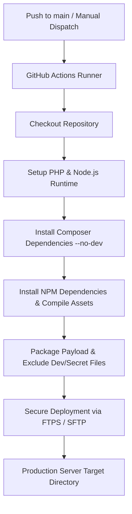

# Continuous Deployment Guide

This document describes the automated deployment workflow configured in `.github/workflows/deploy.yml`, detailing the CI/CD pipeline, required GitHub Secrets and Variables, setup instructions, security hardening, and adaptation to alternative environments (e.g., SSH/Rsync or Containerized deployments).

---

## 1. Pipeline Overview & Architecture

The deployment pipeline automates dependency installation, asset compilation, payload packaging, and deployment to the hosting environment on every push to the `main` branch or manual dispatch.



### Deployment Flow Steps:
1. **Trigger**: Executes automatically on `push` to `main` or manually via `workflow_dispatch`.
2. **Environment Setup**: Configures PHP 8.2+ with required extensions (`pdo_mysql`, `bcmath`, `curl`, etc.) and Node.js 20.x.
3. **Optimized Build**:
   - `composer install --no-dev --optimize-autoloader`
   - `npm ci && npm run build`
4. **Targeted Deployment**: Deploys application payload while strictly excluding development and sensitive files (`.git`, `.github`, `node_modules`, `tests`, `.env*`, `*.sql`, logs).

---

## 2. Required GitHub Secrets and Variables

Configure the following secrets and configuration variables in your repository:

### GitHub Secrets (`Settings` > `Secrets and variables` > `Actions` > `Repository secrets`)

| Name | Type | Purpose | Example Placeholder |
| :--- | :--- | :--- | :--- |
| `FTP_SERVER` | Secret | Hostname or IP of the deployment server | `ftp.example.com` |
| `FTP_USERNAME` | Secret | Dedicated FTP/SFTP deployment user | `deployer@example.com` |
| `FTP_PASSWORD` | Secret | Secure deployment user password | `your-secure-ftp-password` |

### GitHub Variables (`Settings` > `Secrets and variables` > `Actions` > `Repository variables`)

| Name | Type | Purpose | Example Placeholder |
| :--- | :--- | :--- | :--- |
| `PHP_VERSION` | Variable | Target PHP runtime version | `8.2` |
| `NODE_VERSION` | Variable | Target Node.js version | `20` |
| `FTP_PORT` | Variable | Port for connection (21 for FTP/FTPS, 22 for SFTP) | `21` |
| `FTP_PROTOCOL` | Variable | Protocol mode (`ftps` or `ftp`) | `ftps` |
| `DEPLOY_PATH` | Variable | Destination web root path on remote server | `/public_html` |

---

## 3. Configuration Instructions

1. Navigate to your repository on GitHub.
2. Go to **Settings** > **Secrets and variables** > **Actions**.
3. Under the **Secrets** tab, click **New repository secret** and add:
   - `FTP_SERVER`
   - `FTP_USERNAME`
   - `FTP_PASSWORD`
4. Under the **Variables** tab, click **New repository variable** and configure non-sensitive variables such as `DEPLOY_PATH`, `PHP_VERSION`, and `FTP_PROTOCOL`.

---

## 4. Alternative Deployment Methods

### Option A: Modern SSH / Rsync Deployment (Recommended for VPS / Dedicated Servers)

For Linux VPS instances (e.g., AWS EC2, DigitalOcean, Hetzner), SSH/Rsync provides atomic zero-downtime releases.

#### Generating a Dedicated Deploy Key:
```bash
ssh-keygen -t ed25519 -C "github-actions-deploy@example.com" -f deploy_key -N ""
```

1. Add the public key (`deploy_key.pub`) to `~/.ssh/authorized_keys` on your target server.
2. Add the private key (`deploy_key`) to GitHub Secrets as `SSH_PRIVATE_KEY`.
3. Add the server host to GitHub Secrets as `SSH_HOST` and user as `SSH_USER`.
4. Capture host keys using `ssh-keyscan -H -p 22 example.com` and store as `SSH_KNOWN_HOSTS`.

---

## 5. Security Best Practices

- **Least Privilege Access**: Create a dedicated deployment user restricted exclusively to the web root directory (`/var/www/app` or `/public_html`).
- **Encrypted Transmission**: Always enforce `FTPS` (FTP over TLS) or `SFTP` (SSH File Transfer Protocol) instead of unencrypted plain FTP.
- **Never Commit Secrets**: Environment variables (`.env`) must remain isolated on the host server or populated securely via GitHub Actions Secrets during deployment.
- **Audit & Key Rotation**: Periodically rotate SSH private keys and deployment passwords, maintaining strict audit logs of pipeline runs.
- **GitHub Environments**: For production teams, use GitHub Environments with required approval reviewers to gate deployments.
